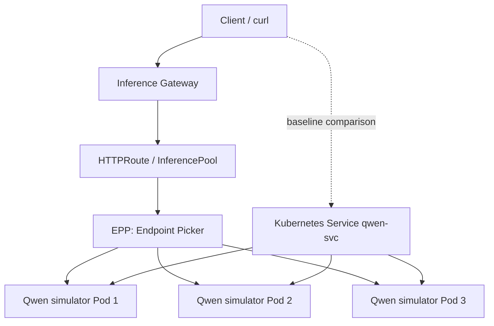

# LLM Inference on Kubernetes — llm-d + Inference Gateway + EPP

A hands-on Kubernetes lab demonstrating how LLM inference traffic can be sent through an inference gateway and routed to model-server Pods by an Endpoint Picker (EPP).

> **Important:** This repository documents a simulator-based lab. The backend image `ghcr.io/llm-d/llm-d-inference-sim:v1.2.0` simulates inference behavior; it does **not** load real Qwen model weights and does not demonstrate real GPU inference. The successful OpenAI-compatible response proves that the request path works, not that a real language model was run.

## What this lab demonstrates

- Deploy multiple model-server replicas in Kubernetes.
- Expose the model servers through a normal Kubernetes Service.
- Send OpenAI-compatible requests through an inference gateway.
- Use an EPP-based inference routing path (when the gateway/EPP components are installed).
- Inspect per-Pod request counters and compare routing observations.
- Generate concurrent requests and record the results.

## Architecture



The gateway and EPP are separate from the model-server Deployment. The exact gateway implementation and EPP Helm values depend on the version and manifests used in the original lab; this repository intentionally does not invent those version-specific resources. See [Gateway and EPP setup](docs/gateway-epp-setup.md).

## Repository layout

```text
.
├── README.md
├── LICENSE
├── .gitignore
├── kind/
│   └── kind-config.yaml
├── kubernetes/
│   ├── namespace.yaml
│   ├── qwen-deployment.yaml
│   └── qwen-service.yaml
├── scripts/
│   ├── deploy.sh
│   ├── port-forward-gateway.sh
│   ├── test-inference.sh
│   ├── load-test.sh
│   └── check-pod-metrics.sh
├── docs/
│   ├── architecture.md
│   ├── gateway-epp-setup.md
│   ├── validation.md
│   └── troubleshooting.md
└── results/
    └── observed-results.md
```

## Prerequisites

- Docker
- `kind`
- `kubectl`
- `curl`
- `jq` (used by the inference test script)
- A local machine with enough CPU/RAM for a three-replica simulator lab

Check tools:

```bash
docker version
kind version
kubectl version --client
curl --version
jq --version
```

## 1. Create a local kind cluster

```bash
kind create cluster --name llm-inference --config kind/kind-config.yaml
kubectl cluster-info --context kind-llm-inference
kubectl get nodes -o wide
```

If you already have the cluster and gateway/EPP lab running, skip this step. Do not create a second cluster with the same name.

## 2. Deploy the model-server simulator

```bash
chmod +x scripts/*.sh
./scripts/deploy.sh
```

Or apply the manifests directly:

```bash
kubectl apply -f kubernetes/namespace.yaml
kubectl apply -f kubernetes/qwen-deployment.yaml
kubectl apply -f kubernetes/qwen-service.yaml
kubectl rollout status deployment/qwen -n llm-inference --timeout=180s
kubectl get pods -n llm-inference -o wide
kubectl get svc -n llm-inference
```

The Deployment uses three replicas and the simulator settings recorded during this lab:

- Image: `ghcr.io/llm-d/llm-d-inference-sim:v1.2.0`
- Model ID: `demo/qwen3-0.6b`
- Port: `8000`
- Max sequences: `4`
- Simulated TTFT: `200ms`
- Simulated inter-token latency: `30ms`
- Load time factor: `2.0`

These are simulator parameters, not real-model performance measurements.

## 3. Set up or connect the inference gateway and EPP

Follow the version-matched instructions in [docs/gateway-epp-setup.md](docs/gateway-epp-setup.md). The gateway/EPP resources used in the original lab were installed separately and are not reconstructed here from guessed manifests.

Confirm the components exist:

```bash
kubectl get pods -A
kubectl get gateway -A
kubectl get httproute -A
kubectl get inferencepool -A
```

Some commands may report that a resource type is unknown if its CRD has not been installed.

## 4. Test the normal Kubernetes Service

Forward the model Service:

```bash
kubectl port-forward -n llm-inference svc/qwen-svc 8001:8000
```

In another terminal:

```bash
curl -sS http://localhost:8001/v1/chat/completions \
  -H 'Content-Type: application/json' \
  -d '{
    "model": "demo/qwen3-0.6b",
    "messages": [{"role": "user", "content": "Explain Kubernetes in one sentence."}]
  }'
```

A Kubernetes Service distributes connections across ready endpoints. It is not inherently aware of prompt length, KV-cache locality, or inference queue state.

## 5. Test through the inference gateway

If the gateway Service is named `inference-gateway` in namespace `default`, use:

```bash
./scripts/port-forward-gateway.sh
```

Otherwise, port-forward the actual gateway Service/namespace used in your deployment. The script defaults can be overridden:

```bash
GATEWAY_NAMESPACE=default \
GATEWAY_SERVICE=inference-gateway \
LOCAL_PORT=8080 \
REMOTE_PORT=80 \
./scripts/port-forward-gateway.sh
```

In another terminal:

```bash
GATEWAY_URL=http://localhost:8080 ./scripts/test-inference.sh
```

The test sends an OpenAI-compatible chat completion request for `demo/qwen3-0.6b`.

## 6. Inspect per-Pod metrics and run a load test

```bash
./scripts/check-pod-metrics.sh
```

Run concurrent requests through the gateway:

```bash
GATEWAY_URL=http://localhost:8080 \
REQUESTS=60 \
CONCURRENCY=12 \
./scripts/load-test.sh
```

Run the metrics script before and after the test. The `vllm:request_success_total` counters are cumulative; subtract the before values from the after values to estimate the number of requests served during that test window.

## What I learned

1. A Kubernetes Service performs ordinary endpoint-level traffic distribution; it does not make inference-aware decisions.
2. An inference gateway provides a controlled entry point for model requests.
3. An Endpoint Picker can use model-serving signals to choose a backend Pod.
4. Per-Pod metrics help validate backend distribution, but counters must be compared as deltas over a defined test window.
5. A simulator is useful for validating the routing architecture without GPUs, but it is not a substitute for real model inference benchmarking.

## Limitations and next steps

- This lab uses a simulator, not real Qwen weights or vLLM model execution.
- Observed request counters are cumulative and should be recorded before and after each test.
- Gateway and EPP manifests are version-specific; use the exact release/guide that matches your installed components.
- A future stage can replace the simulator with a real inference server and a suitably sized model after validating CPU/GPU and memory requirements.
- Add Prometheus/Grafana dashboards and repeatable latency/throughput benchmarks in a later iteration.

## Cleanup

```bash
kubectl delete namespace llm-inference
kind delete cluster --name llm-inference
```

Only delete the cluster if it was created specifically for this lab.

## References

- [llm-d documentation](https://llm-d.ai/docs/)
- [llm-d artifacts and components](https://llm-d.ai/docs/0.7/getting-started/artifacts)
- [llm-d Router repository](https://github.com/llm-d/llm-d-router)
- [Gateway API Inference Extension](https://github.com/kubernetes-sigs/gateway-api-inference-extension)
- [Envoy AI Gateway integration guide](https://github.com/llm-d/llm-d/blob/main/docs/infrastructure/gateway/envoy-ai-gateway.md)

## Author

**Asrafuzzaman (Hasib)** — DevOps / Cloud Engineer

If you find this lab useful, feel free to ⭐ the repository.
